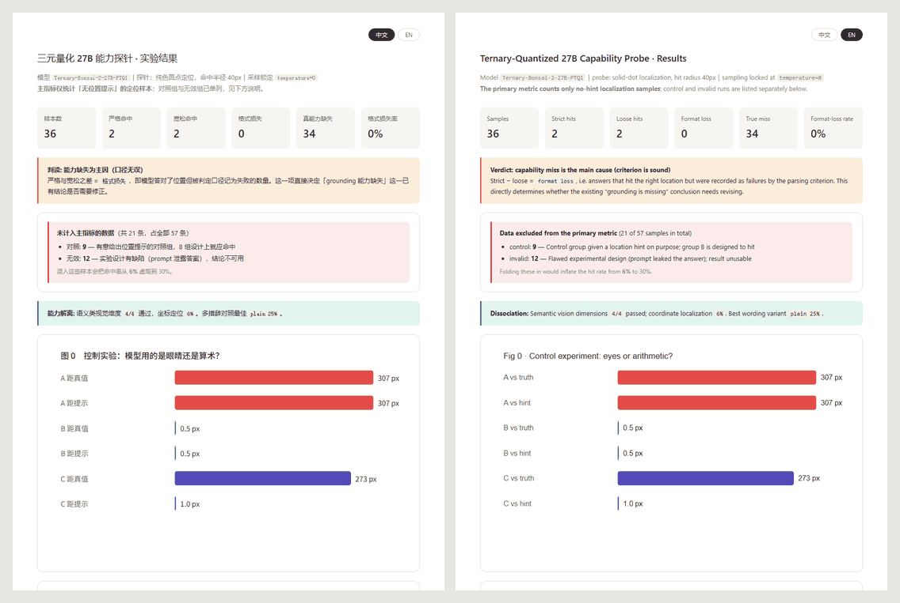
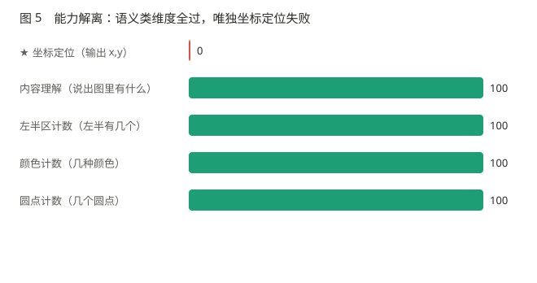
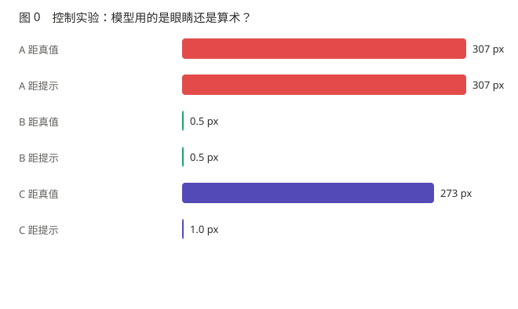

# 三元量化 27B 在 8GB 显存上的能力解离现象

> **一句话**：在 8GB 显存上跑一个三元量化（PTQ1）的 27B 多模态模型，
> 用受控实验测量它在四个能力维度上的实际表现——**结果不是"整体变笨"，
> 而是某些能力被选择性保留、某些直接归零**。

**中文** · [English](README.en.md)

---

## 📄 文档导航

| 文档 | 内容 |
|---|---|
| **[docs/FINDINGS.md](docs/FINDINGS.md)** | **实验正文（中文）：能力解离现象的完整测绘报告**（结论 · 方法 · 局限） |
| **[docs/FINDINGS.en.md](docs/FINDINGS.en.md)** | 同上，英文版 |
| [docs/EXPERIMENT_DESIGN.md](docs/EXPERIMENT_DESIGN.md) | 实验设计（竞争解释排除、判读规则、诚实边界） |
| [docs/TOPICS.md](docs/TOPICS.md) | 八个候选课题与共享实验设计 |
| [experiments/analysis/report.html](experiments/analysis/report.html) | 可视化报告（6 张图 + 57 条原始输出，**右上角可切换 中文 / EN**） |

> **语言切换**：本仓库的正文与 README 各有中英两份（文件名后缀 `.en.md`），
> 页面顶部互链；可视化报告则是**单文件内置切换**，无需重新加载。

### 报告预览（左：中文　右：English）

同一份 `report.html`，右上角一键切换——图表标题、指标名、原始输出表全部跟着变，
**不重新加载页面、不依赖网络**。




### 核心结论速览

> **三元量化 27B 在 8GB 显存上：语义类视觉能力完好（4/4），
> 像素级坐标定位命中率 6%（2/36，无位置提示）。**
>
> 控制实验证明：当 prompt 给出错误位置时，模型精确输出该错误坐标——
> **它没有看图，只在做数字换算。**
>
> → 工程含义：不要用这类模型做定位，改用系统可访问性 API；
> 也不要用「给个大概位置让它微调」——它会采纳你的错误值。

### 实验图

| 解离现象 | 控制实验 |
|---|---|
|  |  |


## 这个项目在研究什么

### 出发点

一个常见的说法是「本地小模型很笨」。这个说法太笼统，无法指导工程决策。

本项目假设并试图检验一个更精确的命题：

> **极低比特量化对模型能力的损失不是均匀的。
> 某些能力几乎无损，另一些直接归零。**

这个命题如果成立，直接推翻了「用平均分（MMLU / perplexity）就能概括量化代价」的
默认做法——**因为平均值会把"完全正常"和"完全失效"平均成一个"轻微下降"。**

### 为什么现在能测

绝大多数量化研究测的是 Q8 → Q4 → Q2 之间的差异。
**Q2 在业界共识里已经是"垃圾"**，所以没人往下测。

本项目用的是**三值权重（-1 / 0 / +1）**——比 Q2 更极端的压缩档位。
配合 KV cache 落盘到系统 RAM 的引擎改造，它能在 8GB 显存上支撑
标称 128K 的上下文。

**这个组合在全球范围内几乎无人复现。** 这不是"我搭了个系统"，
而是"我有一个别人没有的实验平台"。

---

## 实测结果（2026-10-05）

完整报告见 **[docs/FINDINGS.md](docs/FINDINGS.md)**。

| 能力维度 | 实测结果 | 样本 |
|---|---|---|
| 图像内容理解 | **完整** —— 能列出对象及其象限 | 1 |
| 颜色属性识别 | **完整** —— 精确答「2 种颜色」 | 1 |
| 空间分区计数 | **完整** —— 精确答「左半 2 个」 | 1 |
| 目标计数 | **完整** —— 精确答「4 个」 | 1 |
| **像素级坐标定位** | **6%** —— 命中 2/36 | 36 |
| 格式损失 | **0/36** —— 判定口径无责 | 36 |

**关键对照实验**：prompt 中给出一个**错误**的位置提示（50%,50%），
模型精确输出了该错误位置对应的坐标（距离提示 1px，距离真值 273px）。

> **它没有看图，只在做数字换算。视觉通路没有参与推理。**

**跨措辞一致性**：5 种语义等价措辞（含中文）下，
4 个目标点中的 3 个输出**逐字节相同** —— 与提问内容无关。

### 一个曾经被写错、现已更正的数字

本文档早先版本曾记录「坐标定位命中 0/57」。

**那个数字是错的**：它把三类样本混算了 ——
其中 12 条来自一次**prompt 泄露了答案**的实验（结果无效），
另有 9 条属于**有意给位置提示的对照组**（设计上就该命中）。
剔除后的真实值是无提示定位 **2/36**。

`analyze.py` 现已加入 `classify_run()`，
自动区分「无提示定位 / 对照组 / 无效组」，**防止这类混算再发生**。

---

## 实验设计要点

完整的实验矩阵、竞争解释排除方案、判读规则，见
[`docs/EXPERIMENT_DESIGN.md`](docs/EXPERIMENT_DESIGN.md)。

### 四个能力探针

| 探针 | 测什么 | 标准答案如何构造 |
|---|---|---|
| P1 意图分流 | 中文口语语义理解 | 134 条已建基准（危险漏判单独统计） |
| P2 图像内容理解 | 看懂图里有什么 | 合成图 + 人工评分 |
| P3 空间定位 | 能否给出坐标 | **纯色圆点**，坐标无争议 |
| P4 长会话稳定性 | 上下文增长的退化临界点 | 合成轮次脚本 |

**P3 为什么用纯色圆点**：任何真实 UI 元素都可能被误识别。
纯色点排除一切歧义——**答错只能是能力问题，不能是识别问题。**

### 必须排除的三个竞争解释

1. 不是量化造成的，是**模型本身**就这样
2. 不是量化造成的，是**分辨率 / 输入处理**的问题
3. 不是能力缺失，是**输出格式不合规**（最可能推翻已有结论）

### 已知的方法论边界

**本项目没有同源 FP/Q8 基线，因此无法证明"解离是量化造成的"。**

只能说「在 PTQ1 这一量化等级上观察到能力解离」，
不能说「量化导致了能力解离」。要支撑后者需要跨模型对照。

这一限制写在 [`EXPERIMENT_DESIGN.md §5`](docs/EXPERIMENT_DESIGN.md) 里，
**不会被隐藏在措辞中。**

---

## 项目结构

```
engine/          llama.cpp KVMem 分支（二进制，未包含在本仓库）
controller/      防退化护栏、长期记忆、图片索引
feishu-bot/      远程入口、意图分流调用、桌面操作层
qwen/            0.8B 意图分流服务
uia/             Windows UIA / OCR 控件树探针
experiments/     实验代码 + 原始数据（runs/ 与 images/ 均入库，作为证据）
docs/            实验设计、结论正文、图表
tests/           自动化测试
```

---

## 这个项目不是什么

诚实起见，明确列出**本项目没有做到的事**：

- ❌ **没有实现通用 Computer Use**。坐标定位命中率仅 6%（2/36），
  桌面操作改用 Windows UIA 控件树（确定性 API）而非模型视觉。
- ❌ **没有做到完全自主**。当前架构是"模型理解意图 → 系统 API 执行"，
  模型不参与坐标决策。
- ❌ **没有证明量化导致了能力解离**（见上）。
- ❌ **不是完整的量化研究**。只测了一个量化等级、一个模型、
  四个能力维度。

---

## 复现

### 环境

```
GPU:  RTX 4060 Laptop, 8GB VRAM
OS:   Windows
模型: Ternary-Bonsai-2-27B-PTQ1_0.gguf（需自行获取）
引擎: llama.cpp KVMem 分支（需自行构建）
```

### 依赖

```bash
pip install uiautomation winocr mss pillow
```

### 启动

```bat
start_kvmem_all.bat          REM 启动引擎 + 代理 + 分流服务
start_kvmem_all.bat status   REM 查看状态
start_kvmem_all.bat stop     REM 停止
```

### 安全默认值

所有不可逆操作默认拒绝：

- 鼠标键盘操作层**默认关闭**
- 发送目标白名单**默认为空**
- 组合键、Enter、Tab **永久拒绝**（需显式授权）
- 白名单**只在内存，重启即失效**

设计理由见 [`docs/EXPERIMENT_DESIGN.md`](docs/EXPERIMENT_DESIGN.md) 与
代码内注释。

---

## 许可

代码部分见 `LICENSE`。
**模型权重不属于本仓库**，需自行获取并遵守其原始许可。

---

## 引用

如果本项目的实验结论对你有用，欢迎引用。
**如果你发现某个结论在你的环境下不成立，请开 issue 告诉我**——
尤其是能力解离现象，我非常想知道它在别的量化等级下是否复现。

---

*本文档随实验进展更新。当前结论对应 2026-10-05 的数据（36 个无提示定位样本
+ 4 个维度探针），样本量与已知局限见 [FINDINGS.md §6](docs/FINDINGS.md)。*
