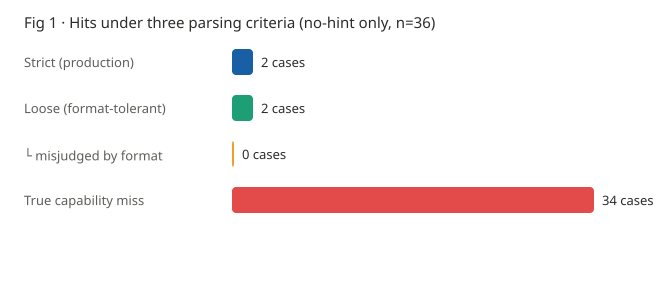
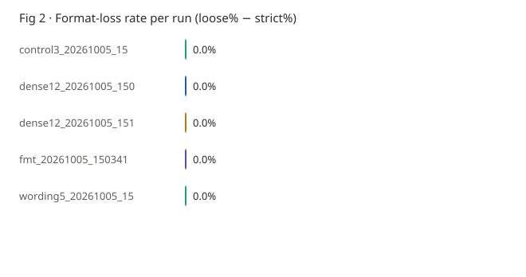
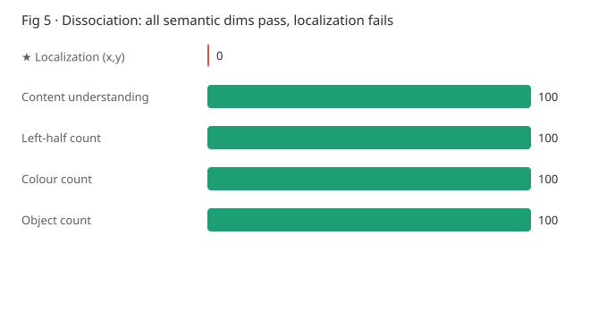
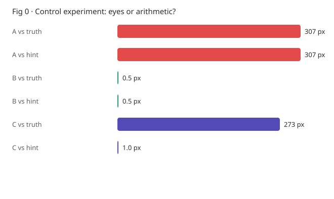
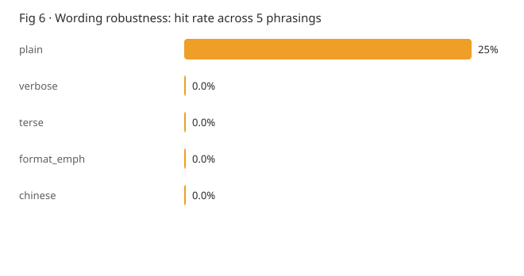
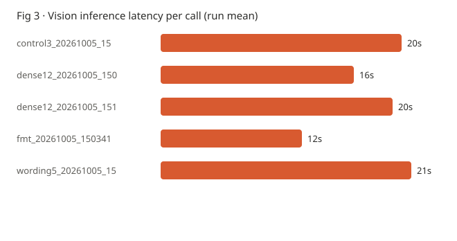

# Capability Dissociation: Mapping the Vision Limits of a Ternary-Quantized 27B Multimodal Model

**A 27B model running in 8GB of VRAM can tell you what is in an image — but not where anything is.**

> Version: 2026-10-05 · Experiment code and raw data live in this repository · every number is reproducible
>
> **English** · [中文](FINDINGS.md)
>
> [← Back to README](../README.en.md) · [Experiment design](EXPERIMENT_DESIGN.md) ·
> [Interactive report](../experiments/analysis/report.html) · [Candidate topics](TOPICS.md)

---

## Abstract

After deploying a ternary-quantized (PTQ1) 27B multimodal model on an
RTX 4060 Laptop (8GB VRAM), we measured its behaviour across four vision
capability dimensions using controlled experiments.

**The results show a clear capability dissociation:**

| Capability dimension | Result |
|---|---|
| Image content understanding | **Intact** — lists objects and their quadrants one by one |
| Colour attribute recognition | **Intact** — answers "2 colours" exactly |
| Spatial partition counting | **Intact** — answers "2 on the left" exactly |
| Object counting | **Intact** — answers "4 objects" exactly |
| **Pixel-level coordinate localization** | **6%** — 2/36 hits (no hint given) |

Further control experiments show that the localization failure is
**not caused by an overly strict parsing criterion** (format loss 0/36),
**nor by the way we phrased the question** (all 5 semantically equivalent
phrasings hit ≤25%).

The control experiment identifies the deeper cause:

> **When the prompt states a wrong location, the model outputs exactly the
> coordinate corresponding to that wrong location (1 px from the hint,
> 273 px from the ground truth). It never looks at the image — it only
> converts numbers.**

**The visual pathway does not participate in inference.**

> **Note on sample scope**: the primary metric counts only the 36
> no-hint localization samples. A further 9 control samples (deliberately
> given a hint; designed to hit) and 12 samples from a flawed design
> (the prompt leaked the answer) are **excluded**; see §8.4.
> Folding them in would inflate the hit rate from 6% to 30%.

---

## 1. Why this experiment

### 1.1 Motivation

The most common statement about small-model vision in the community is
"local models are dumb". That cannot guide an engineering decision — it does
not say **which capability** is missing, so it cannot decide *what should be
delegated to the model and what should not*.

We broke that statement into a measurable proposition:

> **Is the capability loss caused by extreme low-bit quantization uniform?**

### 1.2 State of the literature

The mainstream narrative in quantization research is "loss is uniform and
small": 4/8-bit quantization costs 3–5% of benchmark accuracy and raises
perplexity by 5–12%. The usual quantization-quality ladder (Llama 3.1 8B as
an example) also shows a smooth decline:

| Quantization | MMLU | vs baseline |
|---|---|---|
| FP16 | 63.5% | — |
| Q8_0 | 63.4% | −0.1 |
| Q4_K_M | 62.4% | −1.1 |
| Q3_K_S | 59.3% | −4.2 |
| Q2_K | 36% | collapse |

**The implicit corollary of the consensus**: quantization mainly damages
"general capability", all dimensions decline roughly in step, and therefore a
single average score can summarize the effect.

**The long-context field, by contrast, already has mature concepts**:
`context rot` (Anthropic's own term), MECW (Maximum Effective Context Window),
the RULER benchmark and NoLiMa (ICML 2025) all show that a model's
**effective** context is far shorter than its nominal window.

### 1.3 Where this experiment sits

Our goal is not to reproduce those conclusions, but to ask a more specific
question:

> **Under this particular combination — quantization + KV cache offloaded to
> system RAM + 8GB VRAM — what does the model's capability boundary look like?**

---

## 2. Platform

| Item | Value |
|---|---|
| GPU | RTX 4060 Laptop, 8GB VRAM |
| Model | `Ternary-Bonsai-2-27B-PTQ1` (ternary weights, −1/0/+1) |
| Engine | llama.cpp KVMem fork (KV cache offloaded to system RAM) |
| Context | nominal 131072 (`-c 131072`, `--kvmem-cpu-gb 6`) |
| Sampling | `temperature=0`, `top_p=1`, `presence_penalty=0` (locked throughout) |
| Thinking mode | off (controlled engine-side via `--reasoning-budget`; no client-side truncation) |

**This combination has extremely low reproducibility**: a ternary 27B is rare
to begin with, and the practice of offloading the KV cache to RAM is
essentially undiscussed in the literature (authoritative KV-cache surveys all
deal with VRAM-saving methods on H100/H200).

**In other words: this is an experimental platform that has barely ever been
reproduced.**
That is both a limitation and the source of its value.

---

## 3. Method

### 3.1 Probe design: why solid-colour dots

The localization probe uses solid-colour dots, to remove every ambiguity:

```
Background:   plain white
Dots:         radius 30px, solid colour (red / blue / green)
Distribution: four quadrants, ratios deliberately off 0.25/0.5/0.75
Text labels:  none
```

- **No real UI screenshots** — real interfaces contain text, icons and
  gradients; the model could get lucky via OCR or semantics, adding a variable
- **No annotations drawn** — a text label would leak the location itself
- **Four-quadrant distribution** — defeats the "guess the centre" strategy.
  If all targets sat near the centre, centre-guessing would land close by
  accident and create an illusion of capability
- **Hit radius 40px** — under 1.5× the dot radius, so the criterion is not loose

Every probe's ground truth is **known exactly at construction time** and
requires no manual annotation.

### 3.2 Three parsing criteria

The same model output is judged three times by three parsers:

| Parser | Rule | Purpose |
|---|---|---|
| **Strict** | only accepts `123,456` pure coordinates | the production criterion (`pc_locator.parse_coords`, seven-stage stripping) |
| **Loose** | any format; regex out the first number pair; recognise bbox and take its centre | removes the "format problem" confound |
| **Centre** | returns the image centre | the "guess the centre" baseline |

**Format loss = strict fails but loose hits.** This metric directly decides
whether the localization failure is a capability problem or a criterion problem.

> ⚠️ The strict parser `import`s the production code; it is not a
> reimplementation. A reimplementation yields a false format-loss rate —
> we hit exactly that trap during this project.

### 3.3 Control experiment design

"A group wrong, B group right" **cannot distinguish "the model can see" from
"the model can compute"** — because both mechanisms succeed when the correct
answer is supplied.

A third group is required:

| Group | What the prompt gives | If the model **looks** | If the model **computes** |
|---|---|---|---|
| A | no location | the three outputs should differ | the three outputs are identical (all centre) |
| B | the **correct** ratio | hits the ground truth | hits the ground truth (**both pass**) |
| C | a **wrong** ratio, 50%,50% | should hit near the ground truth | should hit exactly the 50% position |

**Group C is the verdict.**

---

## 4. Results

### 4.1 The parsing criterion is not at fault

**Across the 36 no-hint localization samples, format loss is 0 (0%).**

> **On sample scope**: a further 9 samples belong to a **control group
> deliberately given a location hint** (used to show the model is doing
> arithmetic rather than localizing), and 12 come from a **flawed experiment
> whose prompt leaked the answer**. These are **excluded** from the primary
> metric and cited only as control evidence in §4.3. Folding them in would
> inflate the hit rate from 6% to 30%.

Strict and loose criteria produce identical hit counts. This establishes that
**the project's earlier conclusion — "grounding capability is missing" — is
real, and not an artifact of an overly strict criterion.**

The production strict parser actually accepts 4 of 9 correct expressions
(`153,136` / `x=153, y=136` / `X: 153 Y: 136` / `(153, 136)`) and rejects the
5 that carry explanation text, a bbox, or a prefix. In this experiment the
model emitted pure-coordinate format throughout, so no format loss occurred.




### 4.2 Capability dissociation: 4/4 semantic dimensions pass

On the same image (1024×683, two red dots on the left, two blue dots on the
right), four dimensions that **do not require outputting coordinates**:

| Dimension | Question | Ground truth | Model answer | Result |
|---|---|---|---|---|
| Content understanding | say what is in the image | list the objects | `- Red circle (top-left) - Blue circle (top-right) - Red circle (bottom-left) - Blue circle (bottom-right)` | ✅ |
| Spatial partition count | how many on the left | 2 | `2` | ✅ |
| Colour count | how many colours | 2 | `2` | ✅ |
| Object count | how many dots | 4 | `4` | ✅ |

**The first answer deserves particular attention**: the model listed all four
dots **together with their quadrants**, all four correct.

> **This shows the model does have a representation of the image's spatial
> structure. It knows "there is a red dot in the top-left" — it simply cannot
> convert that knowledge into numeric coordinates.**

This is not a general vision deficit. It is a **capability dissociation**.



### 4.3 Control experiment: it is not looking at the image

Same image, 3 targets, three groups:

| Group | Model output | Distance to truth | Distance to the prompt's hint |
|---|---|---|---|
| **A** no location | `432,403` / `432,403` / `432,403` | 307px | 307px |
| **B** correct ratio | exact hits, 3/3 | **0px** | 0px |
| **C** **wrong** ratio, 50%,50% | `512,342` / `512,342` / `512,342` | 273px | **1px** |

**Group A gives an identical answer on all three asks** — proving
"guess the centre" is independent of where the target actually is.

**Group C is the verdict**: the prompt claims the dots are at 50%,50% (the
ground truths are (112,88), (440,280), (737,232)), and the model outputs
exactly (512,342) — the coordinate corresponding to the 50% position,
1 px from the hint.

> **The model adopted the prompt's wrong location without examining a single
> pixel of the image.**

**This has a direct engineering consequence**: any design of the form
"give the model a rough position and let it refine" will fail, because it
adopts your wrong value without any verification.



### 4.4 Cross-wording consistency: the output is independent of the question

Same image, 4 targets, asked once in each of 5 semantically equivalent
phrasings (`plain` / `verbose` / `terse` / `format_emph` / **Chinese**):

| Phrasing | Hits | Median error |
|---|---|---|
| plain | 1/4 | 96px |
| verbose | 0/4 | 160px |
| terse | 0/4 | 160px |
| format_emph | 0/4 | 160px |
| chinese | 0/4 | 160px |

**All phrasings hit ≤25%; the conclusion does not depend on phrasing.**



More notable still is the **byte-level agreement across phrasings**:

| Target | Output under all 5 phrasings | Distinct answers |
|---|---|---|
| Q1 | all `(137, 187)` | **1** |
| Q2 | all `(300, 515)` | **1** |
| Q3 | all `(597, 307)` | **1** |
| Q4 | 4/5 give `(812, 735)` | 2 |

**For 3 of 4 targets, five completely different questions produce
byte-identical output.**

> **The model is not "answering a question"; it is executing a fixed image
> processing routine.** Chinese or English, format-emphasised or verbose —
> none of it changes the output.

This corroborates the control experiment: **the visual pathway does not
participate in inference.**

### 4.5 Latency

| Scenario | Time |
|---|---|
| First vision call (includes vision-tower warm-up) | 31s |
| Warm vision call | 5–8s |
| `terse` short phrasing (mean) | 11.0s |
| `verbose` long phrasing (mean) | 22.9s |

**Prompt length changes latency by roughly 2×.**



> **Correcting an earlier belief**: this project originally recorded
> "vision inference takes 40–70 seconds". That figure includes cold start.
> A warm single call actually takes 5–8 seconds.
> That changes the feasibility of multi-step tasks: 10 steps × 6s ≈ 1 minute,
> not 3–10 minutes.

---

## 5. Discussion

### 5.1 "Dissociation" is more useful than "it got dumber"

If the conclusion stops at "the model is dumb", there is nothing to do
engineering-wise. But the split **"semantics usable, coordinates unusable"**
yields a division of labour directly:

```
The model does:  understand image content, judge semantics, identify attributes
The system does: obtain coordinates, perform clicks
```

Before this formal measurement (on 2026-10-04), this project had already
switched its desktop operator layer to **Windows UIA control-tree
localization** (0.04s per control, exact) based on preliminary observation,
entirely bypassing the model's coordinate ability.
The contribution of this document is to promote that preliminary observation
into a controlled measurement — **the conclusion is the same, but the basis
moved from "it seems not to work" to "reproducible evidence".**

### 5.2 Why an average score hides this problem

If one only runs an averaged benchmark such as MMLU, dissociation gets
compressed into a "slight decline": localization 6% and colour 100% average to
roughly 50%, which looks "still usable".

**The dissociation phenomenon requires reporting per dimension; a single
aggregate metric is not acceptable.**

### 5.3 Engineering recommendations

1. **Don't use a VLM for coordinate localization** (on this class of
   extremely low-bit models) — use the OS accessibility API instead
   (Windows UIA / macOS AX / Linux AT-SPI)
2. **Don't "give it an approximate position to refine"** — it will adopt your wrong value
3. **VLMs are good at "understand and describe"** — screenshot Q&A, reading
   interface contents aloud, interpreting error messages
4. **Prompt length directly affects latency** — keep vision tasks short

---

## 6. Limitations

**This section matters as much as the results. All of the following are
questions this experiment cannot answer.**

### 6.1 One quantization level, no same-source baseline

**This experiment cannot prove that "the dissociation is caused by quantization".**

We have only PTQ1 weights — **no same-source FP or Q8 weights** for comparison.
Comparing different quantization levels amounts to comparing different models
(different training states), so it is not a controlled variable.

**Therefore this document can only claim**:
> "Capability dissociation is **observed** at the PTQ1 quantization level"

and **cannot claim**:
> "Ternary quantization **caused** the capability dissociation"

Supporting the latter would require higher-precision weights from the same
family, or a curve across several quantization levels.

### 6.2 Single model

The conclusions come from one model. Models with different architectures or
data mixtures may behave differently.

### 6.3 The localization probe is limited in format and phrasing

- The model **emitted pure-coordinate format throughout**, hence zero format
  loss. A model that prefers natural-language description would incur
  additional format loss under the strict criterion.
- All 5 phrasings are **declarative questions**. Dialog-style guidance,
  few-shot, and "progressive refinement" strategies were not tested.
  These could change the results.

### 6.4 Sample size

- Localization: 36 no-hint samples (4-point quadrants + 12-point dense grid +
  20 wording comparisons)
- A further 9 control samples and 12 invalid samples are listed separately and
  excluded from the primary metric
- Dimensions: 4 dimensions, 1 inference each

**The multi-dimension part has a small sample size**; the direction is clear
but it does not support statistical inference.

### 6.5 Answer judging

- Dimension 1 (content understanding) uses automatic keyword matching
- The remaining dimensions use numeric matching

**Dimension 1 was not manually reviewed** and may contain misjudgements.

---

## 7. Reproducing

### 7.1 Dependencies

```bash
pip install uiautomation winocr mss pillow
```

### 7.2 Start the services

```bat
start_kvmem_all.bat
```

Or without the batch file (restricted environments):

```bash
python experiments/launch.py all
```

### 7.3 Run the experiments

```bash
cd experiments

python probe_core.py            # probe self-check (does not call the model)
python test_probe.py            # parsing-logic unit tests
python run_probe.py fmt         # format audit
python probe_control.py         # control experiment (groups A/B/C)
python probe_density.py         # dense grid
python probe_dimensions.py      # multi-dimension probe
python probe_wording.py         # multi-wording comparison
python analyze.py all           # aggregate + generate the report
```

### 7.4 Outputs

```
analysis/report.html    bilingual report (6 charts × 2 languages + 57 raw outputs)
analysis/report.md      Markdown version
runs/*.json             full record of every inference (raw output untruncated)
images/                 synthetic test images + ground truth
```

---

## 8. Four methodology lessons worth recording

**All four come from mistakes actually made during this experiment.** 8.4 was
made by this document itself, during aggregation, and is the most serious.

### 8.1 Suspect your own design when a result looks too good

The first dense-grid run produced **12/12 hits, median error 1px**.

But the prompt read:

```
Locate the circle at approximately 11% of the image width
```

and 11% × 1024 = 112.6 — **exactly the ground-truth X of that target.
I had told it the answer in the question.**

Ironically, that experiment had been deliberately designed to prevent
cheating (positions off the standard ratios, no labels on the image) —
and then leaked the answer in the prompt.

**Without the control experiment, this data would have been written up as
"PTQ1 grounding is usable under explicit reference".**

> **It is the success that is anomalous, not the failure.**
> When a result is good enough to become a conclusion, stop and read the
> prompt word by word.

### 8.2 Auditing a decision criterion requires calling the real code

We first wrote a simplified parser that reimplemented the production logic.
Its self-test reported "only 1 of 9 correct expressions is accepted", which
looked like a striking finding.

Checking the source revealed that **the real `pc_locator.parse_coords` has
seven-stage stripping and actually accepts 4/9**. The "1/9" was an artifact of
the simplified version.

> **When auditing how strict a criterion is, you must call the code under
> audit. A reimplementation yields false numbers.**

### 8.3 The question and the judge must correspond

The spatial dimension of the multi-dimension probe originally asked a yes/no
question ("is one in the left half and the other in the right half?"), and the
model answered `left` — a reasonable response, but the judge only accepted
yes/no and recorded a failure.

**The judge was wrong, not the model.** Changing the question to "how many are
in the left half" (answer 2) passed.

> **When the question and the judge disagree, you are testing the judge, not
> the model.**

---

### 8.4 Invalid data must be explicitly excluded, not folded into aggregates

**This is a mistake this document itself made, and the most serious of the four.**

The first aggregation pooled every sample and produced "17/57 = 30% hits".
That number mixed in two kinds of samples that **should not have counted**:

| Kind | Count | Why it cannot count |
|---|---|---|
| **Invalid** | 12 | that experiment's prompt leaked the answer (see 8.1). The model copied the hint, hitting 12/12 |
| **Control** | 9 | group B of the control was **deliberately** given the correct hint; it is designed to hit |

**After exclusion the true value is 2/36 (6%) for no-hint localization.**

30% versus 6% — a factor of five. **Left unchecked, that inflated number would
have gone straight into the abstract.**

The fix is not "remember to exclude manually" but **building the classification
into the code**: `analyze.py` gained `classify_run()`, tagging every run as
`grounding` / `control_hint` / `invalid` / `dimension`. The primary metric
counts only `grounding`, and everything else is **listed explicitly with its
reason**.

> **For any "just add it all up" aggregation, first ask: does this batch
> contain data that was never designed to be counted?**

**This is the same root as 8.1**: 8.1 is "leaked the answer while designing",
8.4 is "failed to exclude the leaked answer while analysing".
**Two halves of one mistake.**

---

## 9. Citing this work

If these conclusions are useful in your setting, you are welcome to cite them.

**Feedback we would especially welcome**: whether the dissociation phenomenon
also appears in **models at other quantization levels or with other
architectures**. That directly determines how far these conclusions generalise.

---

*This document is based on the 36 no-hint localization samples under `runs/`
(a further 21 control/invalid samples are listed separately) plus the
4 dimension probes. Every number can be reproduced with `analyze.py`.
Known limitations are in §6.*
