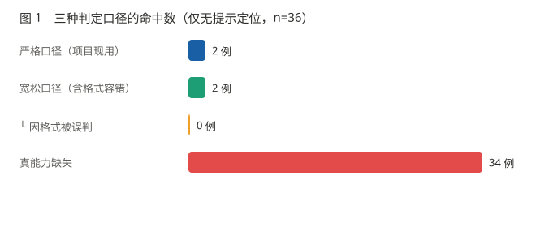
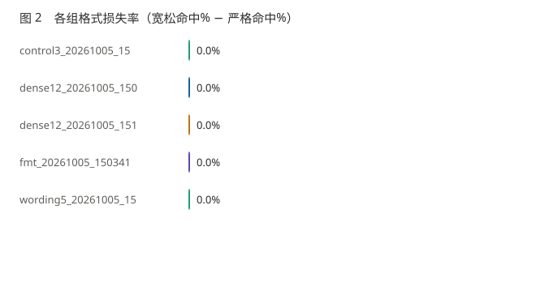
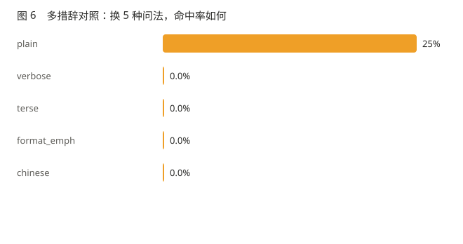
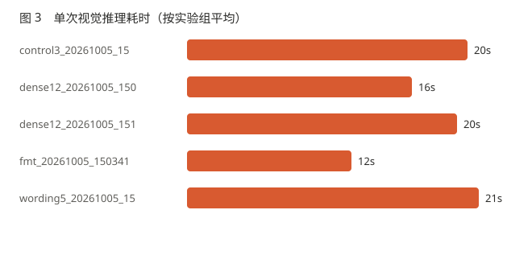

# 能力解离：三元量化 27B 多模态模型的视觉能力边界测绘

**一个跑在 8GB 显存上的 27B 模型，能看懂图里有什么，却说不出东西在哪。**

> 版本：2026-10-05 · 实验代码与原始数据同仓库 · 全部数字可复现
>
> **中文** · [English](FINDINGS.en.md)
>
> [← 返回 README](../README.md) · [实验设计](EXPERIMENT_DESIGN.md) ·
> [可视化报告](../experiments/analysis/report.html) · [候选课题](TOPICS.md)

---

## 摘要

在 RTX 4060 Laptop（8GB 显存）上部署三元量化（PTQ1）的 27B 多模态模型后，
我们用受控实验测量了它在四个视觉能力维度上的表现。

**结果呈现明确的能力解离（dissociation）**：

| 能力维度 | 表现 |
|---|---|
| 图像内容理解 | **完整** —— 能逐个列出对象及其象限 |
| 颜色属性识别 | **完整** —— 精确回答「2 种颜色」 |
| 空间分区计数 | **完整** —— 精确回答「左半 2 个」 |
| 目标计数 | **完整** —— 精确回答「4 个」 |
| **像素级坐标定位** | **6%** —— 命中 2/36（无位置提示） |

进一步的对照实验表明，定位失败**并非判定口径过严**（格式损失 0/36），
**也并非提问方式不当**（5 种语义等价措辞命中率均 ≤25%）。
控制实验证实了更根本的原因：

> **当 prompt 中给出一个错误的位置提示时，模型精确输出了该错误位置对应的坐标
> （距离提示 1px，距离真值 273px）。它没有看图，只在做数字换算。**

**视觉通路没有参与推理过程。**

> **样本口径说明**：主指标仅统计 36 条「无位置提示」的定位样本。
> 另有 9 条对照组（有意给提示，设计上应命中）与 12 条设计有缺陷的样本
> （prompt 泄露答案）**未计入**，详见第 8.4 节。
> 混入这两类会把命中率从 6% 虚高到 30%。

---

## 1. 为什么做这个实验

### 1.1 出发点

关于小模型视觉能力，社区里最常见的一句话是「本地模型很笨」。这句话无法指导工程决策——
它没有说明**具体哪一项能力缺失**，因此无法决定「哪些功能该交给模型、哪些不该」。

我们把这句话拆成可测量的命题：

> **极低比特量化对模型能力的损失是否均匀？**

### 1.2 文献现状

量化研究的主流叙事是「损失均匀且小」：4/8-bit 量化导致 benchmark 准确率下降 3–5%，
perplexity 上升 5–12%。常见的量化质量梯度表（以 Llama 3.1 8B 为例）也呈现平滑下降：

| 量化 | MMLU | 相对基线 |
|---|---|---|
| FP16 | 63.5% | — |
| Q8_0 | 63.4% | −0.1 |
| Q4_K_M | 62.4% | −1.1 |
| Q3_K_S | 59.3% | −4.2 |
| Q2_K | 36% | 崩溃 |

**共识的隐含推论**：量化主要损伤「通用能力」，各维度大致同步下降，
因此用一个平均分即可概括。

**长上下文领域则已有成熟概念**：`context rot`（Anthropic 官方术语）、
MECW（Maximum Effective Context Window）、RULER benchmark 与 NoLiMa（ICML 2025）
都指出模型的**有效**上下文远短于标称窗口。

### 1.3 本实验的位置

我们的目标不是复现这些结论，而是问一个更具体的问题：

> **在「量化 + KV cache 落盘到系统 RAM + 8GB 显存」这个具体组合下，
> 模型的能力边界长什么样？**

---

## 2. 实验平台

| 项 | 值 |
|---|---|
| GPU | RTX 4060 Laptop，8GB VRAM |
| 模型 | `Ternary-Bonsai-2-27B-PTQ1`（三值权重，−1/0/+1） |
| 引擎 | llama.cpp KVMem 分支（KV cache 落盘系统 RAM） |
| 上下文 | 标称 131072（`-c 131072`，`--kvmem-cpu-gb 6`） |
| 采样 | `temperature=0`、`top_p=1`、`presence_penalty=0`（全程锁定） |
| 思考模式 | 关闭（经 `--reasoning-budget` 引擎侧控制，不做客户端截断） |

**这个组合的可复现性极低**：三值量化的 27B 本身罕见，
KV cache 落盘 RAM 的部署方式在学术文献中几乎无人讨论
（KV cache 的权威综述讨论的都是 H100/H200 上的显存节省方法）。

**换言之：这是一个几乎无人复现过的实验平台。**
这既是限制，也是价值所在。

---

## 3. 方法

### 3.1 探针设计：为什么用纯色圆点

定位探针使用纯色圆点，理由是排除一切歧义：

```
背景：纯白
圆点：半径 30px，纯色（红/蓝/绿）
分布：四象限，比例刻意偏离 0.25/0.5/0.75
图上文字标注：无
```

- **不用真实 UI 截图** —— 真实界面有文字、图标、渐变，模型可能靠 OCR 或语义
  猜对，混入额外变量
- **不画任何标注** —— 文字标注会泄露位置本身
- **四象限分布** —— 破坏「往中心猜」策略。若目标点都靠近中心，
  猜中心的策略会偶然接近真值，制造能力假象
- **命中半径 40px** —— 小于圆点半径的 1.5 倍，避免宽松判定

各探针的标准答案均为**构造时可精确已知**的量，不依赖人工标注。

### 3.2 三层判定口径

同一份模型输出用三种解析器各判一次：

| 解析器 | 规则 | 用途 |
|---|---|---|
| **严格** | 只接受「123,456」纯坐标 | 生产代码口径（`pc_locator.parse_coords`，七步剥离） |
| **宽松** | 任意格式，用正则抠第一对数字；识别 bbox 取中心 | 排除「格式问题」干扰 |
| **中心** | 返回图片中心 | 「往中心猜」基线 |

**格式损失 = 严格判失败 但 宽松命中**。这个指标直接决定
「定位失败是能力问题还是口径问题」。

> ⚠️ 严格解析器直接 `import` 生产代码，不做复刻。
> 复刻会得到虚假的格式损失率——这是本项目实测踩过的坑。

### 3.3 控制实验设计

「A 组错、B 组对」**不能区分「模型看得见」和「模型会算」**——
因为给出正确答案时两种机制都成立。

必须加第三组：

| 组 | prompt 给出什么 | 若模型在**看图** | 若模型在**算术** |
|---|---|---|---|
| A | 不给位置 | 三次输出应各不相同 | 三次输出相同（都猜中心） |
| B | **正确**比例 | 命中真值 | 命中真值（**两者都对**） |
| C | **错误**比例 50%,50% | 应命中真值附近 | 应精确命中 50% 对应位置 |

**C 组是判决书。**

---

## 4. 结果

### 4.1 格式口径无责

**36 个「无位置提示」的定位样本，格式损失 0 个（0%）。**

> **关于样本口径**：另有 9 条属于**有意给出位置提示的对照组**（用于证明模型在做算术而非定位），与 12 条**设计有缺陷的实验**（prompt 泄露了答案）。这两类**不计入**主指标，仅在上文第 4.3 节作为对照证据引用。混入后会把命中率从 6% 虚高到 30%。

严格口径与宽松口径的命中数完全一致。这说明
**项目此前「grounding 能力缺失」的结论是真实的，不是判定过严造成的假象。**

生产代码的严格解析器实际接受 9 种正确表达中的 4 种
（`153,136` / `x=153, y=136` / `X: 153 Y: 136` / `(153, 136)`），
拒绝带解释文字、bbox、带前缀等 5 种。
本实验中模型全部使用纯坐标格式输出，因此未触发格式损失。




### 4.2 能力解离：语义维度 4/4 通过

同一张图（1024×683，左侧 2 个红点、右侧 2 个蓝点），四个维度**均不要求输出坐标**：

| 维度 | 问法 | 标准答案 | 模型回答 | 结果 |
|---|---|---|---|---|
| 内容理解 | 说出图里有什么 | 列出对象 | `- Red circle (top-left) - Blue circle (top-right) - Red circle (bottom-left) - Blue circle (bottom-right)` | ✅ |
| 空间分区计数 | 左半有几个 | 2 | `2` | ✅ |
| 颜色计数 | 几种颜色 | 2 | `2` | ✅ |
| 目标计数 | 几个圆点 | 4 | `4` | ✅ |

**维度 1 的回答尤其值得注意**：模型逐个列出了四个圆点**及其所在象限**，
四象限全部正确。

> **这说明模型对图像的空间结构有认知。它知道「左上有一个红点」，
> 但无法把这个认知转换成数字坐标。**

这不是整体视觉能力缺失，是**能力解离**。


### 4.3 控制实验：它没有在看图

同一张图，3 个目标点，三组对照：

| 组 | 模型输出 | 距真值 | 距 prompt 提示位置 |
|---|---|---|---|
| **A** 不给位置 | `432,403` / `432,403` / `432,403` | 307px | 307px |
| **B** 给正确比例 | 精确命中 3/3 | **0px** | 0px |
| **C** 给**错误**比例 50%,50% | `512,342` / `512,342` / `512,342` | 273px | **1px** |

**A 组三次询问输出完全相同** —— 说明「猜中心」与目标位置无关。

**C 组是判决书**：prompt 中声称圆点位于 50%,50%（而真值分别为
(112,88)、(440,280)、(737,232)），模型精确输出了 (512,342) ——
即 50% 位置对应的坐标，距离提示 1px。

> **模型采纳了 prompt 中的错误位置，一个像素都没有看图。**

**这条结论有直接的工程含义**：任何「给模型一个大致位置让它微调」的设计都会失败，
因为它会直接采纳你给的错误值，且不做任何验证。


### 4.4 跨措辞一致性：输出与提问无关

同一张图 4 个目标点，用 5 种语义等价措辞各问一遍
（`plain` / `verbose` / `terse` / `format_emph` / **中文**）：

| 措辞 | 命中 | 中位误差 |
|---|---|---|
| plain | 1/4 | 96px |
| verbose | 0/4 | 160px |
| terse | 0/4 | 160px |
| format_emph | 0/4 | 160px |
| chinese | 0/4 | 160px |

**所有措辞命中率 ≤25%，结论不依赖问法。**



更值得注意的是**跨措辞输出的完全一致**：

| 目标点 | 5 种措辞的输出 | 不同答案数 |
|---|---|---|
| Q1 | 全部 `(137, 187)` | **1** |
| Q2 | 全部 `(300, 515)` | **1** |
| Q3 | 全部 `(597, 307)` | **1** |
| Q4 | 4/5 为 `(812, 735)` | 2 |

**3/4 的目标点，在 5 种完全不同的提问下输出逐字节相同。**

> **模型不是在「回答问题」，而是在执行一个固定的图像处理程序。**
> 问中文还是英文、强调格式还是写成长段，都不改变输出。

这与控制实验的结论互相印证：**视觉通路没有参与推理。**

### 4.5 延迟

| 场景 | 耗时 |
|---|---|
| 首次视觉调用（含视觉塔预热） | 31s |
| 热态视觉调用 | 5–8s |
| `terse` 短问法（平均） | 11.0s |
| `verbose` 长问法（平均） | 22.9s |

**prompt 长度对延迟的影响约 2 倍。**



> **修正一个此前的认知**：本项目早期记录「视觉推理 40–70 秒」，
> 该数字包含冷启动。热态单次实际为 5–8 秒。
> 这改变了多步任务的可行性判断：10 步 × 6s ≈ 1 分钟，而非 3–10 分钟。

---

## 5. 讨论

### 5.1 「解离」比「变笨」更有工程价值

如果结论停在「模型很笨」，工程上无事可做。
而「**语义可用、坐标不可用**」这个划分直接给出了分工原则：

```
模型负责：理解图像内容、判断语义、识别属性
系统负责：坐标获取、点击执行
```

本项目在本次正式测量**之前**（2026-10-04），已据初步观察把桌面操作层改为
**Windows UIA 控件树定位**（0.04 秒/控件，精确），完全绕开了模型的坐标能力。
本文的贡献是把那次初步观察升级为受控测量——**结论相同，但依据从「看起来不行」变成了「可复现的证据」。**

### 5.2 为什么平均分会掩盖这个问题

如果只跑 MMLU 这类平均分benchmark，解离现象会被压缩成一个「轻微下降」：
定位 6% 和颜色 100% 平均后接近 50%，看起来「还能用」。

**能力解离的现象要求按维度分别报告，不接受单一聚合指标。**

### 5.3 工程建议

1. **不要用 VLM 做坐标定位**（在此类极低比特模型上）
   —— 改用系统可访问性 API（Windows UIA / macOS AX / Linux AT-SPI）
2. **不要「给个大概位置让它微调」** —— 它会采纳你的错误值
3. **VLM 适合做「看懂并描述」** —— 截图问答、界面内容朗读、错误信息解读
4. **prompt 长度直接影响延迟** —— 视觉任务宜用简短问法

---

## 6. 局限

**这一节与结论同等重要。以下都是本实验无法回答的问题。**

### 6.1 只有一个量化等级，无同源基线

**本实验无法证明「解离是量化造成的」。**

我们只有 PTQ1 权重，**没有同源 FP 或 Q8 权重**做对照。
不同量化等级之间的比较等于换了模型（训练状态不同），不构成受控变量。

**因此本文只能声称**：
> 「在 PTQ1 这一量化等级上，观察到能力解离现象」

而**不能声称**：
> 「三元量化导致了能力解离」

要支撑后者，需要同系列更高精度权重的对照，或跨多个量化等级的曲线。

### 6.2 单模型

结论来自单一模型。不同架构、不同数据配比的模型可能表现不同。

### 6.3 定位探针有格式与措辞的局限

- 模型在本文实验中**全部使用纯坐标格式输出**，因此格式损失为 0。
  若模型倾向输出自然语言描述，严格口径会额外产生格式损失。
- 5 种措辞均为**陈述式提问**，未测试对话式引导、few-shot、
  或「逐步逼近」类策略。这些可能改变结果。

### 6.4 样本量

- 定位：36 个无位置提示样本（4 点四象限 + 12 点加密网格 + 20 次措辞对照）
- 另 9 条对照组样本与 12 条无效样本已单列，未计入主指标
- 维度：4 个维度，每维 1 次推理

**多维度部分样本量偏小**，结论方向明确但不宜做统计推断。

### 6.5 答案判定方式

- 维度 1（内容理解）使用关键词自动判定
- 其余维度使用数字匹配

**维度 1 未做人工复核**，可能存在误判。

---

## 7. 复现

### 7.1 依赖

```bash
pip install uiautomation winocr mss pillow
```

### 7.2 启动服务

```bat
start_kvmem_all.bat
```

或不经 bat（受限环境）：

```bash
python experiments/launch.py all
```

### 7.3 运行实验

```bash
cd experiments

python probe_core.py            # 探针自检（不调模型）
python test_probe.py            # 判定逻辑自测
python run_probe.py fmt         # 格式审计
python probe_control.py         # 控制实验（A/B/C 三组）
python probe_density.py         # 加密网格
python probe_dimensions.py      # 多维度探针
python probe_wording.py         # 多措辞对照
python analyze.py all           # 汇总 + 生成报告
```

### 7.4 产出

```
analysis/report.html    可视化报告（6 张内嵌 SVG 图 + 57 条原始输出）
analysis/report.md      Markdown 版
runs/*.json             每次推理的完整记录（原始输出不截断）
images/                 合成测试图 + 标准答案
```

---

## 8. 值得记录的四个方法论教训

**这四条全部来自本次实验过程中实际犯的错**，其中 8.4 是本文档自身在汇总阶段犯的，且最严重。

### 8.1 好得可疑的结果，先怀疑自己的设计

第一轮加密网格实验拿到 **12/12 命中，中位误差 1px**。

但 prompt 写的是：

```
Locate the circle at approximately 11% of the image width
```

而 11% × 1024 = 112.6 —— **正是该目标点的真值 X。我在提问里告诉了它答案。**

讽刺的是，那次实验本来是特意设计防作弊的（位置避开标准比例、图上不画标注），
却在 prompt 里泄了底。

**如果没有控制实验，这批数据会以「PTQ1 模型的 grounding 在明确指代下可用」
的结论写进报告。**

> **异常的是成功本身，不是失败。**
> 当结果好到能当结论用时，先停下来逐字读一遍 prompt。

### 8.2 审计判定口径必须调用真实代码

最初我们写了一个简化版解析器复刻生产逻辑，
自测跑出「9 种正确表达只认 1 种」，看起来是个惊人的发现。

查证后发现**真实的 `pc_locator.parse_coords` 有七步剥离逻辑，实际能认 4/9**。
那个「1/9」是简化版制造的假象。

> **审计「某个判定有多严」时，必须调用被审计的那份代码本身。复刻会得到虚假的数字。**

### 8.3 判定的问法必须与标准答案对应

多维度探针的空间维度最初出的是 yes/no 题
（「一个在左半，另一个在右半吗」），模型回答 `left`——
这是合理回应，但判定器只认 yes/no，于是记为未通过。

**是判定器错了，不是模型错了。** 改为「左半有几个」（答案 2）后通过。

> **问法与判定不一致时，你测的是判定器，不是模型。**

---

### 8.4 无效数据必须显式剔除，不能混入聚合指标

**这是本文档自身犯过的错，且是四条里最严重的一条。**

第一版汇总把全部样本混在一起算，得到「命中 17/57 = 30%」。
但这个数字里混着两类**不该计入**的样本：

| 类型 | 条数 | 为什么不能计入 |
|---|---|---|
| **无效** | 12 | 那次实验的 prompt 泄露了答案（见 8.1）。模型照抄提示，命中 12/12 |
| **对照组** | 9 | control 组的 B 组**有意**给出正确位置提示，设计上就应该命中 |

**剔除后的真实值是无提示定位 2/36（6%）。**

30% 和 6%，差 5 倍。**如果不查，这个虚高的数字会直接写进摘要。**

修法不是「记得手动排除」，而是**在代码里建立分类**：
`analyze.py` 新增 `classify_run()`，为每个 run 打上
`grounding` / `control_hint` / `invalid` / `dimension` 标签，
主指标只统计 `grounding`，其余**显式列出并说明原因**。

> **凡是"顺手全加起来"的聚合，都要先问：这批数据里有没有
> 设计上就不该算进来的？**

**本条与 8.1 同源**：8.1 是「设计时泄露了答案」，
8.4 是「分析时没剔除泄露的答案」。**同一个错误的两半。**

---

## 9. 引用这份工作

如果这些结论对你的场景有用，欢迎引用。

**特别欢迎反馈的是**：能力解离现象在**其他量化等级或其他架构的模型**上
是否同样存在。这直接决定本文结论的可推广范围。

---

*本文档基于 `runs/` 下的 36 个无位置提示定位样本（另有 21 条对照组/无效样本已单列）与 4 个维度探针撰写。
所有数字可由 `analyze.py` 复现。已知局限见第 6 节。*
